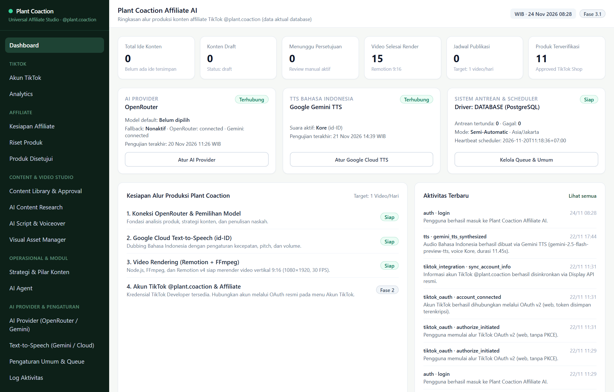
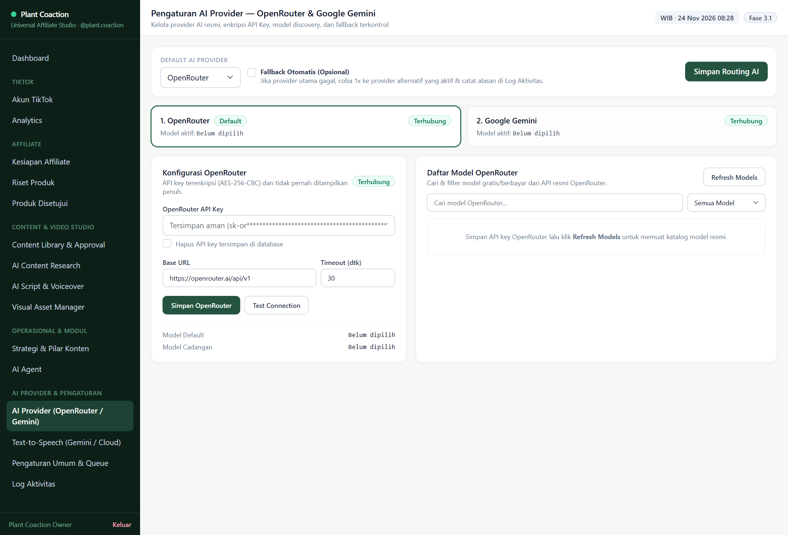
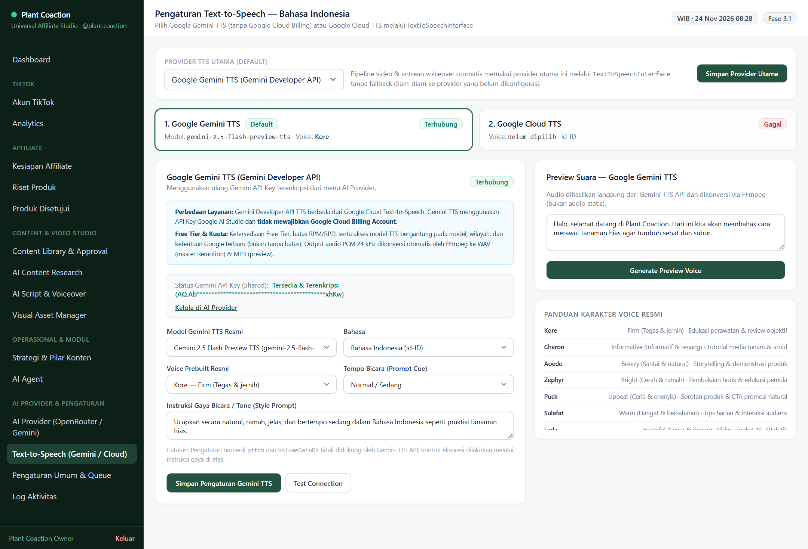
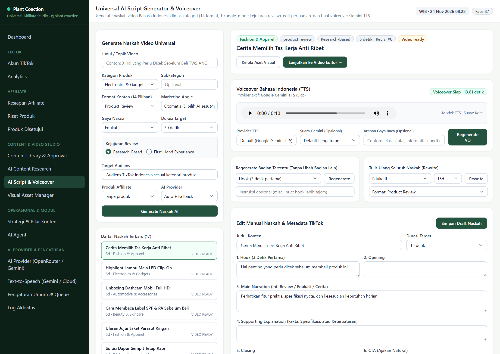
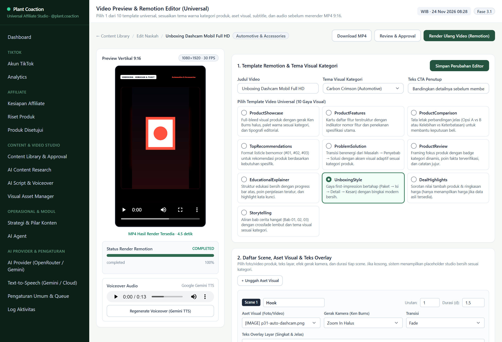
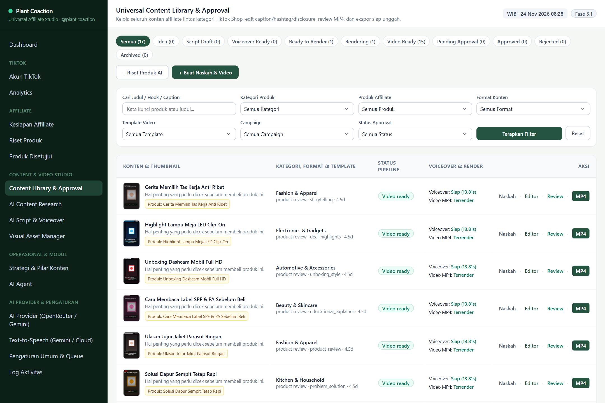
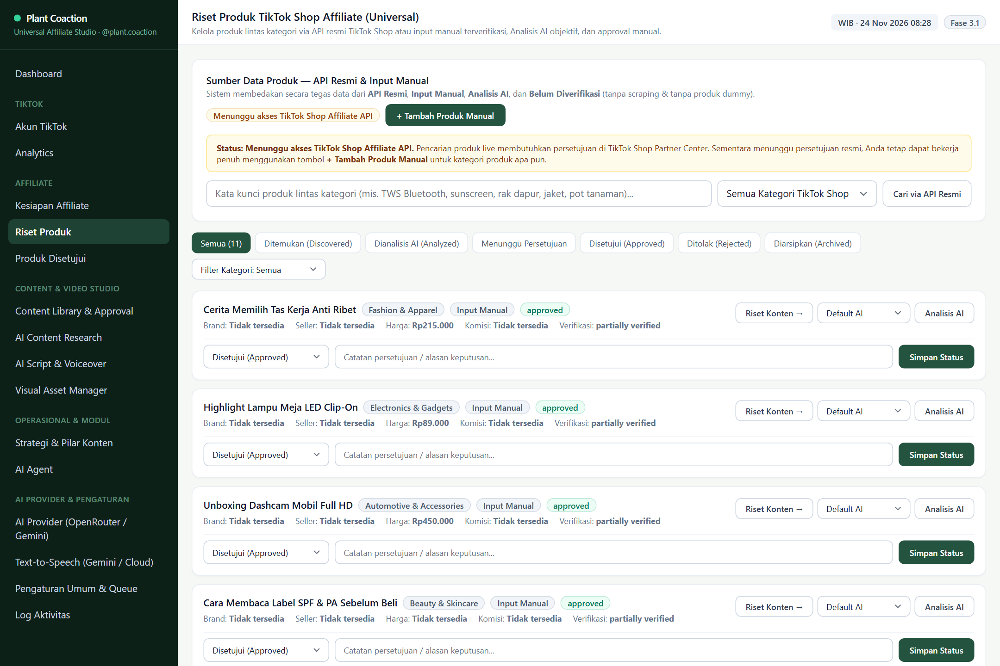

# Cultiv TikTok AI Affiliate Platform

**Cultiv TikTok AI Affiliate Platform** (*Cultiv Auto*) is an AI-powered SaaS platform for TikTok Shop affiliate product research, product opportunity analysis, AI marketing content generation, vertical 9:16 video production, and creator-authorized affiliate workflow management.

Built to support **all TikTok Shop product categories** (Electronics & Gadgets, Fashion & Apparel, Beauty & Skincare, Health & Personal Care, Home & Living, Kitchen & Household, Automotive, Sports & Outdoor, Baby & Kids, Pet Supplies, Food & Beverage, Books & Education, Toys & Hobbies, Plants & Gardening, and General/Custom categories) with human-in-the-loop review and strict review-honesty controls (*Research-Based* vs *First-Hand Experience*).

---

## Project Overview

- **Universal Product Category & Catalog System:** Dynamic hierarchical categories (`product_categories` with subcategories) supporting official API imports (when approved) and transparent manual product entry (`official_api` vs `manual_input` vs `ai_analysis` vs `unverified`).
- **Universal AI Product Research:** Multi-category product analysis (15-point structured breakdown) with anti-hallucination guardrails and strict separation between *Research-Based* content and *First-Hand Experience*.
- **Universal AI Script & Voiceover Studio:** 14 content formats, 10 marketing angles, 6 narration styles, 5 video durations (`15s`–`90s`), per-section regeneration, manual editing, and Indonesian Text-to-Speech via **Google Gemini TTS** or **Google Cloud TTS**.
- **Remotion v4 Video Producer:** 10 category-aware universal 9:16 templates (`ProductShowcase`, `ProductFeatures`, `ProductComparison`, `TopRecommendations`, `ProblemSolution`, `ProductReview`, `EducationalExplainer`, `UnboxingStyle`, `DealHighlights`, `Storytelling`) plus legacy backward-compatible templates, rendered asynchronously via a 4-stage Laravel Queue pipeline (`1080×1920`, `30 FPS`, H.264 + AAC MP4).
- **Content Library & Human-in-the-Loop Approval:** 10 pipeline statuses, 7-dimension filtering, inline caption/hashtag/affiliate-disclosure editing, MP4 preview, approval audit logs, and manual MP4 export.
- **Official TikTok Integrations:**
  - **TikTok Login Kit Web OAuth v2:** Implemented with CSRF `state` validation, encrypted token storage (`Laravel Crypt`), refresh-token rotation, and minimal `user.info.basic` scope.
  - **TikTok Shop Affiliate API:** Client integration and approval workflows are implemented; **live Affiliate API access is currently pending official TikTok Shop Partner Center certification and approval** (manual product input and analysis workflows remain fully operational in the meantime).

---

## Platform Screenshots

### 1. Main Dashboard & Production Readiness
Overview of rendered 9:16 videos, verified affiliate products, active AI provider, Indonesian TTS voiceover status, queue & scheduler health, and real-time activity logs.



### 2. AI Multi-Provider & Controlled Fallback (OpenRouter & Google Gemini)
Encrypted API key storage (`AES-256-CBC` via `Laravel Crypt`), official model discovery, provider switching, and optional single-step fallback routing.



### 3. Indonesian Voiceover & Text-to-Speech (Google Gemini TTS & Cloud TTS)
Indonesian (`id-ID`) narration configuration using Google Gemini TTS (reusing the encrypted Gemini API key without requiring Google Cloud Billing) or Google Cloud TTS, with prebuilt voice characters and live FFmpeg-converted audio previews.



### 4. Universal AI Script Generator & Voiceover Studio
Multi-category script generation supporting 14 content formats, 10 marketing angles, *Research-Based* vs *First-Hand Experience* honesty controls, per-section regeneration, manual editing, and direct Gemini TTS voiceover playback.



### 5. Remotion v4 Video Producer & 9:16 Editor
Interactive vertical `1080×1920` (`30 FPS`) video editor with 10 category-aware universal templates, adaptive visual themes, scene timeline & Ken Burns camera controls, integrated voiceover playback, and asynchronous Remotion render tracking.



### 6. Universal Content Library & Human-in-the-Loop Approval
Multi-category content pipeline with 10 status stages, 7-dimension filtering, voiceover/render indicators, inline metadata editing, and direct MP4 download.



### 7. Universal Affiliate Product Catalog & AI Research
Multi-category TikTok Shop affiliate product research with transparent source labeling (`official_api` vs `manual_input`), AI opportunity analysis, and manual approval workflow.



---

## Technology Stack

- **Backend:** Laravel 12 (`PHP 8.2+`), Modular Service Architecture (`app/Modules/`), Eloquent Policies
- **Database:** PostgreSQL 18 (with `JSONB` support)
- **Frontend:** Blade, Tailwind CSS 3, Alpine.js 3, Vite 5
- **Video Rendering:** Remotion 4 (`React 18`, `TypeScript 5.6`), FFmpeg / FFprobe, Headless Chrome/Edge
- **AI & TTS Providers:** OpenRouter, Google Gemini Developer API (multi-provider routing + controlled fallback), Google Gemini TTS, Google Cloud Text-to-Speech
- **Async Processing:** Laravel Queue (`database` driver) & Scheduler (`Asia/Jakarta`)

---

## Requirements

- PHP `8.2+` with extensions: `pdo_pgsql`, `pgsql`, `openssl`, `mbstring`, `curl`, `fileinfo`, `zip`, `gd`
- Composer `2.8+`
- PostgreSQL `16+` / `18`
- Node.js `22+` and `npm`
- FFmpeg & FFprobe available on `PATH`
- Google Chrome or Microsoft Edge (for Remotion headless rendering)

---

## Installation Steps

```bash
# 1. Clone repository
git clone https://github.com/bhottu/cultiv-tiktok-ai-affiliate-platform.git
cd cultiv-tiktok-ai-affiliate-platform

# 2. Install PHP dependencies
composer install

# 3. Install root frontend dependencies
npm install

# 4. Install Remotion studio dependencies
cd remotion
npm install
cd ..

# 5. Copy environment template and generate app key
cp .env.example .env
php artisan key:generate
```

---

## Environment Configuration

Configure your local `.env` (never commit `.env` to Git; refer to `.env.example` for all supported keys):

- **Application & Database:** `APP_URL`, `APP_TIMEZONE=Asia/Jakarta`, `DB_CONNECTION=pgsql`, `DB_HOST`, `DB_PORT`, `DB_DATABASE`, `DB_USERNAME`, `DB_PASSWORD`
- **AI Providers (also configurable encrypted via Dashboard UI):** `OPENROUTER_API_KEY`, `GEMINI_API_KEY`, `AI_DEFAULT_PROVIDER`, `AI_FALLBACK_ENABLED`
- **Text-to-Speech:** `TTS_DEFAULT_PROVIDER=google_gemini_tts` (reuses encrypted Gemini API key) or `google_cloud_tts` (`GOOGLE_TTS_API_KEY` / `GOOGLE_CLOUD_TTS_CREDENTIALS`)
- **Video & Remotion:** `REMOTION_PROJECT_PATH=remotion`, `FFMPEG_BINARY=ffmpeg`, `FFPROBE_BINARY=ffprobe`
- **TikTok Login Kit OAuth v2:** `TIKTOK_OAUTH_PLATFORM=web`, `TIKTOK_CLIENT_KEY`, `TIKTOK_CLIENT_SECRET`, `TIKTOK_REDIRECT_URI=https://<your-https-domain>/dashboard/tiktok/callback`, `TIKTOK_OAUTH_SCOPES=user.info.basic`
- **TikTok Shop Affiliate API (when officially approved):** `TIKTOK_SHOP_APP_KEY`, `TIKTOK_SHOP_APP_SECRET`, `TIKTOK_SHOP_ACCESS_TOKEN`

---

## Database Migration & Seeding

Ensure your PostgreSQL database exists (and a separate test database such as `affiliate_ai_tiktok_test` for PHPUnit), then run:

```bash
php artisan migrate --seed
```

This creates all application tables and seeds the 15 universal TikTok Shop root categories + 59 subcategories (`ProductCategorySeeder`). Remember to update the initial seeded owner credentials immediately in non-local environments.

---

## Frontend Build & Remotion Setup

```bash
# Build production CSS/JS assets (required when serving via HTTPS reverse proxy / ngrok)
npm run build

# Verify Remotion TypeScript compositions
cd remotion
npx tsc --noEmit
cd ..
```

---

## Running the Application, Queue Worker & Scheduler

Run each process in a separate terminal:

```bash
# Terminal 1 — Web application server
php artisan serve --host=127.0.0.1 --port=8000

# Terminal 2 — Queue worker (required for Remotion video rendering jobs)
php artisan queue:work --tries=2 --timeout=700

# Terminal 3 — Task scheduler (Asia/Jakarta)
php artisan schedule:work
```

---

## AI Provider & TikTok OAuth Configuration

1. **AI Providers (`/settings/ai-providers`):** Configure OpenRouter and/or Google Gemini Developer API keys via the dashboard (stored encrypted using `Laravel Crypt`), test connectivity, discover models, and optionally enable controlled single-step fallback.
2. **Text-to-Speech (`/settings/tts`):** Select **Google Gemini TTS** (default; shares the encrypted Gemini key) or **Google Cloud TTS**, choose an Indonesian voice profile, and preview audio.
3. **TikTok OAuth (`/dashboard/tiktok`):** Register an HTTPS Web Redirect URI matching `TIKTOK_REDIRECT_URI` under TikTok Login Kit (Web) in the TikTok Developer Portal. Start with `TIKTOK_OAUTH_SCOPES=user.info.basic` until additional Display API scopes (`user.info.profile`, `user.info.stats`) are approved.
4. **TikTok Shop Affiliate API (`/dashboard/affiliate`):** Remains in *awaiting official API access* state until TikTok Shop Partner Center approval is granted; manual product registration and AI analysis are available immediately.

---

## Testing Instructions

```bash
# Clear bootstrap caches
php artisan optimize:clear

# Run full PHPUnit test suite (uses isolated test DB configured in phpunit.xml)
php artisan test

# Validate Composer configuration
composer validate --no-check-publish

# Verify frontend production build & Remotion types
npm run build
cd remotion && npx tsc --noEmit
```

---

## Key Documentation

- [PROJECT_ARCHITECTURE.md](PROJECT_ARCHITECTURE.md)
- [DATABASE_SCHEMA.md](DATABASE_SCHEMA.md)
- [PHASE_3_VIDEO_RENDERING_GUIDE.md](PHASE_3_VIDEO_RENDERING_GUIDE.md)
- [PHASE_3_1_UNIVERSAL_CONTENT_GUIDE.md](PHASE_3_1_UNIVERSAL_CONTENT_GUIDE.md)
- [TIKTOK_OAUTH_SETUP.md](TIKTOK_OAUTH_SETUP.md)
- [AFFILIATE_API_ACCESS_REQUIREMENTS.md](AFFILIATE_API_ACCESS_REQUIREMENTS.md)
- [DEVELOPMENT_LOG.md](DEVELOPMENT_LOG.md)
